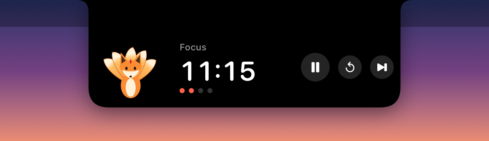
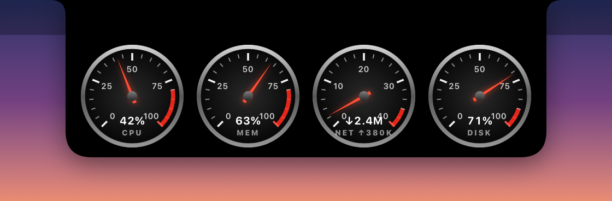
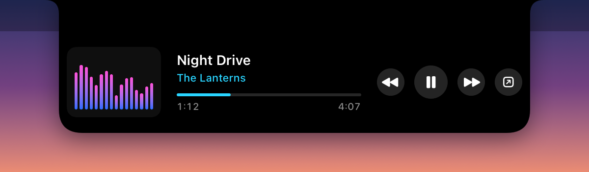

# NotchSwitcher

A small macOS agent that turns the MacBook notch into a launcher and a few live widgets. Hover
the notch and it grows into a panel; move away and it tucks back in.

- **App switcher**: the running apps in a Dock-style row with magnification; click one to
  bring it forward. A dot marks the app in front.
- **Mirror**: your camera in a little mirror under the notch.
- **Pomodoro**: a focus timer with a kitsune that grows a tail for each ninth of a session;
  while it runs, the collapsed notch shows a ring and the time either side of the notch.
- **Quick Note**: a scratch note, autosaved to
  `~/Library/Application Support/NotchSwitcher/note.txt`.
- **System**: car-dashboard gauges for CPU, memory, network and disk.
- **Nightjar**: now playing from [Nightjar](https://github.com/mustafa89/nightjar), with
  a spectrum, progress, play/pause and skip, and a Live Activity (a note badge and live bars
  beside the notch) while music plays.
- **Typo Fixer**: opens the settings of a separate Typo Fixer app, if you have it
  (`local.typofixer`).

Without a hardware notch it draws a notch-sized pill under the menu bar instead.


| Pomodoro | System gauges |
|---|---|
|  |  |

| Nightjar now playing | Live Activity while music plays |
|---|---|
|  |  |

The images are rendered from the app's own views with sample data (`tools/render.sh`).

## Requirements and build

macOS 14 or later on Apple silicon, and the Xcode Command Line Tools (`xcode-select --install`).
No Xcode project or SwiftPM: `build.sh` compiles the sources with `swiftc`.

```sh
./build.sh                      # builds build/NotchSwitcher.app (ad-hoc signed)
open build/NotchSwitcher.app    # an agent app: no Dock icon; right-click the notch to quit
```

The mirror asks for camera access the first time it opens.

`tools/render.sh` re-renders the README images into `docs/`: no window, no screen capture,
and the real note file is never read.

## Nightjar link

Nightjar sends a JSON status over UDP to `127.0.0.1:47811` (state, title, artist, position,
length, 20 spectrum bands and its skin's colours), 30 times a second while playing and once a
second otherwise; NotchSwitcher sends `toggle`, `next` or `prev` back to `127.0.0.1:47812`.
Both ends bind the loopback address only. Without Nightjar the panel says it isn't running and
offers to open it.
